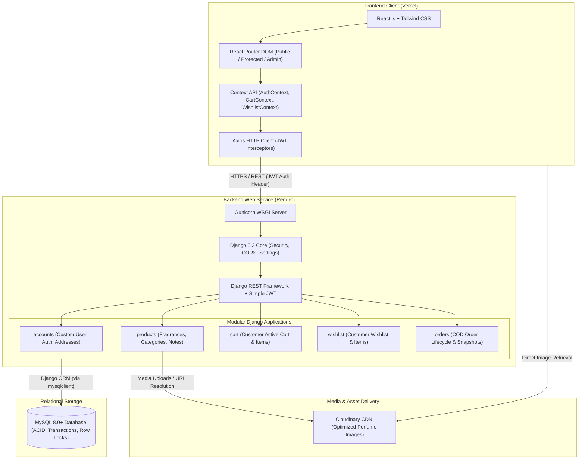
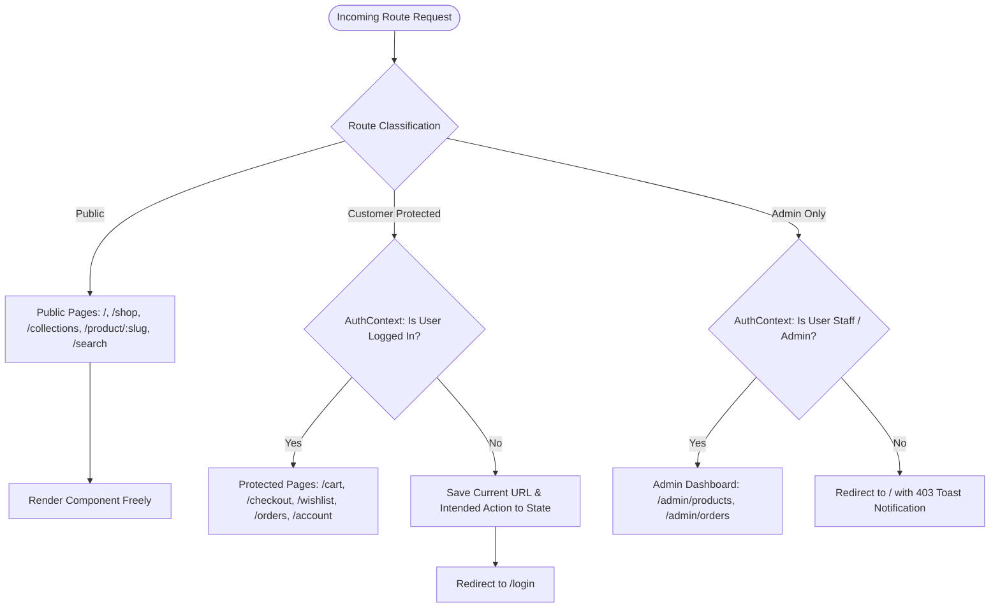
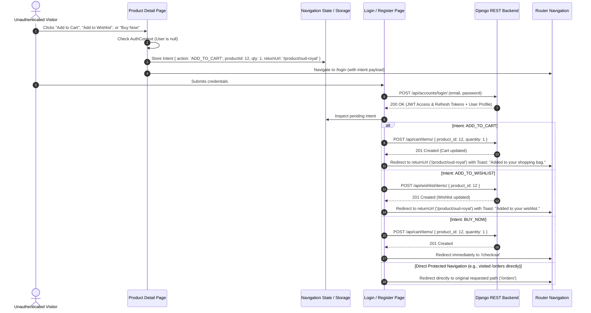

# MISTY — System Architecture & Technical Specification

## 1. Executive Summary & Brand Overview

**MISTY** is a luxury fragrance and perfume e-commerce web platform engineered with a modern, decoupled architecture. The platform delivers an elegant visual presentation, seamless discovery of fragrance pyramids (top, heart, and base notes), robust customer account management, server-side cart and wishlist persistence, and a Cash on Delivery (COD) order management lifecycle.

---

## 2. Technology Stack & Compatibility Decisions

| Tier | Technology | Version / Release | Role & Architectural Justification |
| :--- | :--- | :--- | :--- |
| **Backend Framework** | Python / Django | `Python 3.11.x` / `Django 5.2 LTS` | Django 5.2 is the official Long-Term Support (LTS) release, supported through 2028. It delivers enterprise-grade stability, modern asynchronous ORM improvements, and built-in security. |
| **API Layer** | Django REST Framework | `djangorestframework ~= 3.15.2` | The gold standard for building robust, browsable, self-documenting REST APIs with flexible serializers and permission classes. |
| **Authentication** | Simple JWT | `djangorestframework-simplejwt ~= 5.4.0` | Stateless JSON Web Token authentication fully verified and compatible with DRF 3.15 and Django 5.2. Employs short-lived access tokens and rotatable refresh tokens. |
| **Database Engine** | MySQL | `8.0+` | Battle-tested relational database providing strict ACID transactions, row-level locking, and referential integrity. |
| **Database Driver** | `mysqlclient` | `~= 2.3.0` | **Sole primary driver**. Uses the official C-based MySQL C client library bindings. Binary wheels (`mysqlclient-*-win_amd64.whl`) install natively on Windows x64 without compilation errors and ensure maximum throughput and thread safety. |
| **Image Storage** | Cloudinary | `cloudinary ~= 1.41.0` | Managed high-performance cloud storage and CDN for high-resolution perfume imagery and automated responsive transformations. |
| **Frontend Framework** | React.js / Vite | `React 18.3.1` / `Vite 5.4.x` | High-performance client-side rendering with instant HMR (Hot Module Replacement) and optimized tree-shaking production builds. |
| **Styling** | Tailwind CSS | `~= 3.4.17` | Utility-first CSS framework providing a stable design system for high-end luxury styling, custom typography, and responsive layouts. |
| **Client Routing** | React Router DOM | `~= 6.28.x` | Industry-standard declarative routing supporting route guards, history manipulation, and navigation state preservation. |
| **HTTP Client** | Axios | `~= 1.7.9` | Feature-rich HTTP client configured with centralized base URLs, authentication request interceptors, and automated 401 response handling. |
| **Icons** | Lucide React | `~= 0.469.0` | Clean, minimalist, modern iconography suitable for luxury e-commerce (shopping bag, search, heart, user). |
| **Runtime Environment**| Node.js | `Node.js 20 or 22 LTS` | Long-Term Support runtime ensuring node/npm ecosystem compatibility across developer machines and build environments. |
| **Hosting (Frontend)** | Vercel | Production Edge CDN | Global edge network with native single-page application (SPA) routing and SSL certificates. |
| **Hosting (Backend)** | Render | Python Web Service | Managed containerized environment running Gunicorn with automated zero-downtime deploys and persistent background tasks. |

---

## 3. High-Level System Architecture



---

## 4. Proposed Folder Structure

```text
Misty/
├── .gitignore                        # Universal ignore file for Python, Node, OS, and env files
├── README.md                         # Project documentation and developer onboarding guide
├── docs/
│   └── architecture.md               # Master system architecture & technical specification
│
├── backend/
│   ├── .env.example                  # Template for backend secrets and database settings
│   ├── requirements.txt              # Pinned Python package dependencies
│   ├── manage.py                     # Django administrative utility
│   ├── core/                         # Master Django project package
│   │   ├── __init__.py
│   │   ├── settings.py               # Settings (AUTH_USER_MODEL, DB, JWT, CORS, Cloudinary)
│   │   ├── urls.py                   # Master API router aggregating app routes
│   │   ├── wsgi.py                   # WSGI entrypoint for Gunicorn production server
│   │   └── asgi.py                   # ASGI entrypoint for asynchronous features
│   │
│   └── apps/                         # Domain-driven Django application packages
│       ├── __init__.py
│       ├── accounts/                 # Custom User model, address books, JWT auth
│       ├── products/                 # Perfume catalog, collections, fragrance pyramids
│       ├── cart/                     # Server-side user shopping carts
│       ├── wishlist/                 # Customer saved perfume wishlists
│       └── orders/                   # Order placement, COD management, item snapshots
│
└── frontend/
    ├── .env.example                  # Template for frontend environment variables
    ├── package.json                  # Pinned NPM dependencies and build scripts
    ├── index.html                    # Single-page application HTML entrypoint
    ├── vite.config.js                # Vite build and development server configuration
    ├── tailwind.config.js            # Tailwind typography, theme extensions, luxury palette
    ├── postcss.config.js             # PostCSS plugins (Tailwind & Autoprefixer)
    └── src/
        ├── main.jsx                  # React application bootstrapper
        ├── App.jsx                   # Master component mounting Providers and Router
        ├── api/                      # Axios HTTP client, token interceptors, endpoint wrappers
        ├── assets/                   # Brand assets, logos, placeholder images
        ├── components/
        │   ├── common/               # Reusable atomic UI: buttons, inputs, modals, spinners
        │   ├── layout/               # Header, Luxury Navbar, Footer, Layout wrapper
        │   ├── products/             # ProductCard, FragrancePyramid, FilterDrawer, Grid
        │   └── routing/              # ProtectedRoute, AdminRoute guards
        ├── context/                  # Global Context providers (AuthContext, CartContext, WishlistContext)
        ├── hooks/                    # Reusable React hooks (useAuth, useCart, useWishlist)
        ├── pages/                    # Routed page views (Home, Shop, ProductDetail, Cart, Checkout, Orders, Account, Login, Register)
        └── utils/                    # Formatters (currency, fragrance concentration tags, date helpers)
```

---

## 5. Django Modular Application Architecture

### 5.1. `apps.accounts`
* **Custom User Model**:
  * Inherits from `AbstractBaseUser` and `PermissionsMixin`.
  * Configured in `settings.py` via `AUTH_USER_MODEL = 'accounts.User'` **strictly before running the initial database migration**.
  * Primary identifier: `email` (`USERNAME_FIELD = 'email'`).
  * Core attributes: `email` (unique), `full_name`, `phone`, `is_staff` (admin panel access), `is_superuser`, `is_active`, `date_joined`.
* **Address Model**:
  * Stores reusable shipping addresses for authenticated customers.
  * Attributes: `user` (FK to User, `CASCADE`), `recipient_name`, `phone`, `address_line1`, `address_line2`, `city`, `state`, `postal_code`, `is_default`.

### 5.2. `apps.products`
* **Category / Collection Model**:
  * Represents fragrance families (e.g., *Woody, Oriental, Fresh, Floral*) and curated collections (e.g., *Privé Collection, Nocturne Series*).
* **Product Model**:
  * Represents individual luxury perfumes.
  * Perfume-specific attributes:
    * `concentration`: Enum (`Parfum`, `Eau de Parfum [EDP]`, `Eau de Toilette [EDT]`, `Extrait de Parfum`).
    * `volume_ml`: Integer bottle size (e.g., 50, 100).
    * `fragrance_family`: String or foreign key.
    * `top_notes`, `heart_notes`, `base_notes`: Fragrance olfactory pyramid descriptions.
    * `price`: `DecimalField(max_digits=10, decimal_places=2)`.
    * `discount_price`: Optional `DecimalField(max_digits=10, decimal_places=2, null=True, blank=True)`.
    * `stock_quantity`: Non-negative integer tracking live stock.
    * `is_active`: Boolean flag allowing soft disabling without breaking historical orders.
* **ProductImage Model**:
  * Manages high-resolution images hosted on Cloudinary (`cloudinary_public_id`, `image_url`, `is_primary`).

### 5.3. `apps.cart`
* **Cart Model**:
  * Enforces **one cart per customer** via `OneToOneField(settings.AUTH_USER_MODEL, on_delete=models.CASCADE, related_name='cart')`.
* **CartItem Model**:
  * Links a product to the cart with a quantity counter.
  * Enforces **a product can appear only once in a specific cart** via database constraint `UniqueConstraint(fields=['cart', 'product'], name='unique_cart_product')`.

### 5.4. `apps.wishlist`
* **Wishlist Model**:
  * Enforces **one wishlist per customer** via `OneToOneField(settings.AUTH_USER_MODEL, on_delete=models.CASCADE, related_name='wishlist')`.
* **WishlistItem Model**:
  * Links a saved product to the wishlist with an `added_at` timestamp.
  * Enforces **a product can appear only once in a specific wishlist** via database constraint `UniqueConstraint(fields=['wishlist', 'product'], name='unique_wishlist_product')`.

### 5.5. `apps.orders`
* **Order Model**:
  * Encapsulates the Cash on Delivery order lifecycle.
  * Order statuses: `PENDING`, `CONFIRMED`, `PROCESSING`, `SHIPPED`, `DELIVERED`, `CANCELLED`.
  * Financial integrity: `total_amount` and `shipping_fee` as `DecimalField(max_digits=10, decimal_places=2)`.
  * **Shipping Address Snapshot**: Direct order-level fields capturing the delivery details (`shipping_recipient_name`, `shipping_phone`, `shipping_address_line1`, `shipping_address_line2`, `shipping_city`, `shipping_state`, `shipping_postal_code`). Subsequent modifications to the user's saved address book will have **zero effect** on past orders.
* **OrderItem Model**:
  * **Product Snapshot**: Stores immutable historical data at order time:
    * `product_name`: Exact name of the perfume when purchased.
    * `product_volume_ml`: Bottle volume when purchased.
    * `unit_price`: `DecimalField(max_digits=10, decimal_places=2)` reflecting the exact price paid per unit.
    * `quantity`: Positive integer.
    * `subtotal`: `DecimalField(max_digits=10, decimal_places=2)`.
  * Prevents catalog edits, price increases, or product renaming from altering historical transactions.

---

## 6. Database Schema, Constraints & Relational Integrity

### 6.1. Entity Relationship Diagram

```mermaid
erDiagram
    USER ||--o{ ADDRESS : "has saved"
    USER ||--|| CART : "owns (1-to-1)"
    USER ||--|| WISHLIST : "owns (1-to-1)"
    USER ||--o{ ORDER : "places (PROTECT)"

    CATEGORY ||--o{ PRODUCT : "categorizes"
    PRODUCT ||--o{ PRODUCT_IMAGE : "displays"

    CART ||--o{ CART_ITEM : "contains"
    PRODUCT ||--o{ CART_ITEM : "references (CASCADE)"

    WISHLIST ||--o{ WISHLIST_ITEM : "contains"
    PRODUCT ||--o{ WISHLIST_ITEM : "references (CASCADE)"

    ORDER ||--o{ ORDER_ITEM : "contains (CASCADE)"
    PRODUCT ||--o{ ORDER_ITEM : "tracks history (SET_NULL)"

    USER {
        bigint id PK
        string email UK "Primary Login"
        string full_name
        string phone
        boolean is_staff
        boolean is_superuser
        boolean is_active
        datetime date_joined
    }

    ADDRESS {
        bigint id PK
        bigint user_id FK "CASCADE"
        string recipient_name
        string phone
        string address_line1
        string address_line2
        string city
        string state
        string postal_code
        boolean is_default
    }

    CATEGORY {
        bigint id PK
        string name UK
        string slug UK
        string description
        string banner_url
    }

    PRODUCT {
        bigint id PK
        bigint category_id FK "PROTECT"
        string name
        string slug UK
        string concentration
        int volume_ml
        decimal price "10,2"
        decimal discount_price "10,2"
        int stock_quantity "Non-negative"
        string top_notes
        string heart_notes
        string base_notes
        boolean is_active
        datetime created_at
    }

    PRODUCT_IMAGE {
        bigint id PK
        bigint product_id FK "CASCADE"
        string cloudinary_public_id
        string image_url
        boolean is_primary
    }

    CART {
        bigint id PK
        bigint user_id FK_UK "CASCADE, 1-to-1"
        datetime updated_at
    }

    CART_ITEM {
        bigint id PK
        bigint cart_id FK "CASCADE"
        bigint product_id FK "CASCADE"
        int quantity
    }

    WISHLIST {
        bigint id PK
        bigint user_id FK_UK "CASCADE, 1-to-1"
        datetime created_at
    }

    WISHLIST_ITEM {
        bigint id PK
        bigint wishlist_id FK "CASCADE"
        bigint product_id FK "CASCADE"
        datetime added_at
    }

    ORDER {
        bigint id PK
        string order_number UK
        bigint user_id FK "PROTECT"
        decimal total_amount "10,2"
        decimal shipping_fee "10,2"
        string payment_method "COD"
        string payment_status "PENDING, PAID"
        string order_status "PENDING, CONFIRMED, SHIPPED, DELIVERED, CANCELLED"
        string shipping_recipient_name
        string shipping_phone
        string shipping_address_line1
        string shipping_address_line2
        string shipping_city
        string shipping_state
        string shipping_postal_code
        text notes
        datetime created_at
    }

    OrderItem {
        bigint id PK
        bigint order_id FK "CASCADE"
        bigint product_id FK "SET_NULL (Historical)"
        string product_name "Snapshot"
        int product_volume_ml "Snapshot"
        decimal unit_price "Snapshot (10,2)"
        int quantity
        decimal subtotal "Snapshot (10,2)"
    }
```

### 6.2. Foreign Key Deletion Strategies

* **`User -> Order` (`on_delete=models.PROTECT`)**: Prevents deletion of a user record if historical orders exist. Financial audit logs and invoice histories are preserved.
* **`Product -> OrderItem` (`on_delete=models.SET_NULL`, `null=True, blank=True`)**: If a fragrance is archived or removed from the active catalog, historical line items remain intact with their saved snapshots (`product_name`, `product_volume_ml`, `unit_price`, and `subtotal`).
* **`User -> Cart` and `User -> Wishlist` (`on_delete=models.CASCADE`)**: Transient carts and wishlists are cleaned up if the owning account is purged.
* **`Cart -> CartItem` and `Wishlist -> WishlistItem` (`on_delete=models.CASCADE`)**: Removing a cart or wishlist automatically removes its constituent items.
* **`Product -> CartItem` and `Product -> WishlistItem` (`on_delete=models.CASCADE`)**: If a product is deleted, references in carts and wishlists are cleanly purged.

### 6.3. Concurrency, Transactions & Stock Protection

To prevent **race conditions** (such as two customers purchasing the final bottle of a limited-edition perfume simultaneously), order checkout uses explicit **database transactions** and **row-level locking**:

```python
# Conceptual transaction boundary for checkout
from django.db import transaction

with transaction.atomic():
    # 1. Acquire pessimistic row locks on all target product records
    locked_products = Product.objects.select_for_update().filter(id__in=product_ids)
    
    # 2. Re-validate real-time inventory against requested quantities
    for item in cart_items:
        product = locked_products.get(id=item.product_id)
        if product.stock_quantity < item.quantity:
            raise ValidationError(f"Insufficient stock for {product.name}.")
            
    # 3. Deduct stock atomically
    for item in cart_items:
        product = locked_products.get(id=item.product_id)
        product.stock_quantity -= item.quantity
        product.save(update_fields=['stock_quantity'])
        
    # 4. Create immutable Order and OrderItems snapshots
    # 5. Clear the customer's Cart
    # 6. Commit transaction
```

---

## 7. Route and Access Tier Separation



### 7.1. Frontend Route Tiering
* **Public Tier**: Accessible to any visitor. Includes Homepage, Fragrance Catalog (`/shop`), Collections (`/collections`), Product Details (`/product/:slug`), Search (`/search`), Login (`/login`), and Registration (`/register`).
* **Customer Protected Tier** (guarded by `<ProtectedRoute>`):
  * Carts (`/cart`), Wishlists (`/wishlist`), Checkout (`/checkout`), Order History (`/orders`), and Profile (`/account`).
  * Unauthenticated attempts are intercepted: the current path and intent payload are recorded, and the user is redirected to `/login`.
* **Staff / Admin Tier** (guarded by `<AdminRoute>`):
  * Requires `user.is_authenticated && user.is_staff === true`.
  * Unauthorized users are blocked from rendering administrative management views.

### 7.2. Backend Permission Enforcement
* `rest_framework.permissions.AllowAny`: Public product listings, categories, fragrance pyramid info, search, customer registration, and login.
* `rest_framework.permissions.IsAuthenticated`: Cart endpoints, wishlist endpoints, checkout, and personal order viewing.
* `rest_framework.permissions.IsAdminUser`: Inventory management, adding products, updating order fulfillment statuses.

---

## 8. Authentication Intent Handling Specification

When an unauthenticated customer initiates an action that requires an active account, MISTY preserves their intent without friction:



### Backend Price & Stock Authority Rule
* **Frontend prices are strictly untrusted**.
* The frontend transmits only `product_id` and `quantity`.
* The Django backend retrieves the product from MySQL, resolves active promotional discounts, checks live stock, and computes all subtotals, shipping fees, and order totals authoritatively on the server.

---

## 9. Local Development & Deployment Strategy

* **Local Development**:
  * Backend: Python virtual environment, Django development server on `http://127.0.0.1:8000/`.
  * Frontend: Vite development server on `http://localhost:5173/`.
  * Database: Local MySQL 8.0 server with database `misty_db`.
* **Deployment Setup**:
  * **Frontend (Vercel)**:
    * Monorepo root directory set to `frontend`.
    * Build command: `npm run build`.
    * Output directory: `dist`.
    * Single Page Application rewrites configured (`vercel.json`).
  * **Backend (Render)**:
    * Root directory set to `backend`.
    * Build command: `pip install -r requirements.txt && python manage.py collectstatic --no-input`.
    * Start command: `gunicorn core.wsgi:application --bind 0.0.0.0:$PORT`.
    * Production MySQL instance provided via managed cloud database (e.g., Render MySQL or AWS RDS).

